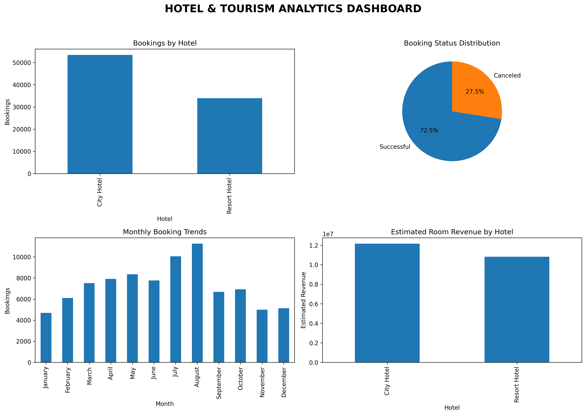

# 🏨 Hotel & Tourism Analytics Platform

### Turning Hotel Booking Data into Meaningful Business Insights

A Python-based Data Analytics project that explores hotel booking data to understand customer behaviour, booking patterns, cancellation trends, hotel performance and estimated room revenue.

**Built using Python, Pandas and Matplotlib.**

---

## 📌 Project Overview

The hospitality industry generates large amounts of booking data. Analysing this data helps hotels understand customer preferences, identify cancellation patterns, evaluate business performance and make better decisions.

This project analyses the **Hotel Booking Demand dataset**, containing booking information from City Hotels and Resort Hotels.

The objective is to transform raw booking records into meaningful insights through data cleaning, exploratory data analysis (EDA), statistical analysis and data visualization.

## 🎯 Project Objectives

- Analyse hotel booking patterns and trends.
- Identify booking cancellation behaviour.
- Compare City Hotel and Resort Hotel performance.
- Understand customer types and repeat guest behaviour.
- Analyse average daily rates and estimated room revenue.
- Study customer stay duration and booking lead time.
- Generate visual reports and a consolidated analytics dashboard.

## 🛠️ Technology Stack

| Technology | Purpose |
|---|---|
| Python | Main programming language |
| Pandas | Data cleaning and analysis |
| Matplotlib | Data visualization |
| CSV | Dataset storage |
| Git & GitHub | Version control |
| VS Code | Development environment |

## 📂 Project Structure

```text
hotel-tourism-analytics/
│
├── data/
│   ├── hotel_bookings.csv
│   └── processed/
│       └── hotel_bookings_cleaned.csv
│
├── daily-tasks/
│   ├── day_01/
│   ├── day_02/
│   ├── day_03/
│   ├── day_04/
│   ├── day_05/
│   ├── day_06/
│   ├── day_07/
│   ├── day_08/
│   ├── day_09/
│   └── day_10/
│
├── visualizations/
│   ├── day-03-bookings.png
│   ├── day-03-cancellations.png
│   ├── day-04-customer-types.png
│   ├── day-04-repeat-customers.png
│   ├── day-04-market-segments.png
│   └── ... other generated charts
│
├── main.py
├── requirements.txt
├── project_output.txt
└── README.md
```

## 📊 Project Modules – 10 Days of Analysis

| Day | Module | Description |
|---|---|---|
| 01 | Dataset Inspection | Explore dataset structure, missing values and duplicates. |
| 02 | Data Cleaning | Handle missing values and remove duplicate records. |
| 03 | Booking Analysis | Analyse hotel-wise bookings and cancellation rates. |
| 04 | Customer Analysis | Explore customer types, repeat guests and market segments. |
| 05 | Revenue Analytics | Estimate room revenue and compare ADR. |
| 06 | Booking Trends | Analyse monthly bookings, lead time and stay duration. |
| 07 | Cancellation Insights | Investigate cancellation patterns. |
| 08 | Hotel Performance | Compare hotel bookings, ADR and customer retention. |
| 09 | Final Dashboard | Combine key metrics and charts. |
| 10 | Final Analysis | Generate final statistics and project findings. |

---

## 📈 Visualizations & Charts

All generated charts are stored in the `visualizations/` folder.

**Click any chart name below to view the visualization on GitHub.**

### Day 3 – Booking Analysis

- [📊 Bookings by Hotel](visualizations/day-03-bookings.png)
- [📊 Cancellation Rate by Hotel](visualizations/day-03-cancellations.png)

### Day 4 – Customer Analysis

- [📊 Customer Types](visualizations/day-04-customer-types.png)
- [📊 Repeat Customer Analysis](visualizations/day-04-repeat-customers.png)
- [📊 Market Segment Analysis](visualizations/day-04-market-segments.png)

### Day 5 – Revenue Analytics

- [💰 Hotel Revenue Comparison](visualizations/day-05-hotel-revenue.png)
- [📊 Monthly Revenue Analysis](visualizations/day-05-monthly-revenue.png)
- [📊 Average Daily Rate](visualizations/day-05-average-daily-rate.png)

### Day 6 – Booking Trends

- [📊 Monthly Booking Trends](visualizations/day-06-monthly-bookings.png)
- [📊 Stay Duration Analysis](visualizations/day-06-stay-duration.png)

### Day 7 – Cancellation Insights

- [📊 Cancellation by Customer Type](visualizations/day-07-customer-cancellations.png)
- [📊 Cancellation by Lead Time](visualizations/day-07-lead-time-cancellations.png)
- [📊 Cancellation by Hotel](visualizations/day-07-hotel-cancellations.png)

### Day 8 – Hotel Performance

- [📊 Total Bookings by Hotel](visualizations/day-08-hotel-bookings.png)
- [📊 Average Daily Rate by Hotel](visualizations/day-08-hotel-adr.png)
- [📊 Average Stay Duration](visualizations/day-08-hotel-stay.png)
- [📊 Repeat Guest Percentage](visualizations/day-08-repeat-guests.png)

### Day 9 – Final Analytics Dashboard

**Complete project dashboard:**



[🔍 View Full Dashboard](visualizations/day-09-final-dashboard.png)

The dashboard combines:

- Hotel-wise booking distribution
- Booking cancellation status
- Monthly booking trends
- Estimated room revenue by hotel

*Note: Chart links will work once the corresponding PNG files have been generated and pushed to GitHub.*

---

## 📁 Dataset Information

**Dataset:** Hotel Booking Demand

**Source:** [Kaggle – Hotel Booking Demand Dataset](https://www.kaggle.com/datasets/jessemostipak/hotel-booking-demand)

Original dataset information:

| Metric | Value |
|---|---:|
| Total records | 119,390 |
| Total columns | 32 |
| Hotel types | City Hotel, Resort Hotel |

Important dataset columns:

| Column | Description |
|---|---|
| hotel | Type of hotel |
| is_canceled | Whether booking was canceled |
| lead_time | Days between booking and arrival |
| arrival_date_month | Month of arrival |
| stays_in_weekend_nights | Weekend stay duration |
| stays_in_week_nights | Weekday stay duration |
| adults | Number of adults |
| country | Guest country |
| customer_type | Customer category |
| is_repeated_guest | Whether guest has booked before |
| adr | Average Daily Rate |

## 🧹 Data Cleaning Process

The original dataset was inspected before analysis.

Initial dataset:

| Metric | Value |
|---|---:|
| Total records | 119,390 |
| Total columns | 32 |
| Duplicate records | 31,994 |

Missing values identified:

| Column | Missing Values |
|---|---:|
| Company | 112,593 |
| Agent | 16,340 |
| Country | 488 |
| Children | 4 |

Cleaning operations:

1. Removed exact duplicate rows.
2. Replaced missing country values with `Unknown`.
3. Filled missing children values using the median.
4. Converted reservation status dates into datetime format.
5. Saved the cleaned dataset for further analysis.

<text>**Final cleaned dataset: 87,396 records and 32 columns.**</text>

Agent and company missing values were retained rather than filled with arbitrary values.

## 🔍 Key Analytical Results

The following results were obtained during the initial booking analysis on the cleaned dataset.

### 1. Hotel-wise Booking Distribution

| Hotel | Total Bookings |
|---|---:|
| City Hotel | 53,428 |
| Resort Hotel | 33,968 |
| **Total** | **87,396** |

City Hotel received more bookings than Resort Hotel.

### 2. Cancellation Analysis

| Hotel | Canceled Bookings | Cancellation Rate |
|---|---:|---:|
| City Hotel | 16,049 | 30.04% |
| Resort Hotel | 7,976 | 23.48% |

**Key Insight:** City Hotel had a higher cancellation rate than Resort Hotel, with a difference of approximately 6.56 percentage points.

### 3. Overall Booking Status

The original dataset contained 44,224 canceled bookings and 75,166 non-canceled bookings. Subsequent analysis uses the cleaned dataset.

## 💻 Installation & Setup

### Step 1: Clone the repository

```bash
git clone YOUR_GITHUB_REPOSITORY_URL
```

### Step 2: Navigate to the project folder

```bash
cd hotel-tourism-analytics
```

### Step 3: Install dependencies

```bash
python -m pip install -r requirements.txt
```

### Step 4: Add the dataset

Ensure the original dataset is available at:

```text
data/hotel_bookings.csv
```

If it is not included in the repository, download it from the Kaggle link above and place it inside the `data/` folder.

### Step 5: Run the complete project

```bash
python main.py
```

The main script executes the available analysis modules in sequence.

To run an individual module:

```bash
python daily-tasks/day_03/booking_analysis.py
```

## 📦 Requirements

Create `requirements.txt` with:

```text
pandas
matplotlib
```

Python 3.x is required.

## 📋 Generated Output Files

| File | Purpose |
|---|---|
| `data/processed/hotel_bookings_cleaned.csv` | Cleaned dataset |
| `visualizations/` | Generated charts and dashboard |
| `daily-tasks/day_XX/output.txt` | Individual execution output |
| `daily-tasks/day_10/final_summary.txt` | Final analytical summary |
| `project_output.txt` | Complete project execution log |

## 💡 Business Applications

This analysis can help hotel management:

- Understand which hotel type receives more bookings.
- Identify booking cancellation patterns.
- Evaluate customer retention through repeat guest analysis.
- Understand seasonal booking trends.
- Compare average daily rates across hotels.
- Estimate room revenue from non-canceled bookings.
- Make informed decisions about hotel operations and customer engagement.

## ⚠️ Project Limitations

- Analysis is based on historical booking data.
- Removing exact duplicate rows may also remove legitimate identical booking records.
- Missing agent and company values are retained.
- Estimated room revenue is calculated using ADR multiplied by total stay nights for non-canceled bookings. It is not actual accounting revenue and excludes taxes, additional services and other charges.
- This is an offline Python analytics application, not a live hotel booking system.

## 🚀 Future Enhancements

- Build an interactive dashboard using Streamlit.
- Add filters for hotel type, year and customer segment.
- Add predictive models for booking cancellations.
- Forecast hotel booking demand.
- Deploy the analytics dashboard online.

---

## 👨‍💻 Project Information

| Detail | Information |
|---|---|
| Project Title | Hotel & Tourism Analytics Platform |
| Domain | Data Analytics |
| Programming Language | Python |
| Libraries | Pandas, Matplotlib |
| Project Type | Academic / Data Analytics Project |

### ⭐ Project Summary

The Hotel & Tourism Analytics Platform demonstrates how raw hotel booking data can be transformed into structured information and meaningful business insights.

Through a step-by-step analytical workflow, the project explores data cleaning, exploratory analysis, customer behaviour, cancellation patterns, revenue estimation and hotel performance.

**Built with Python, Pandas and Matplotlib.**
